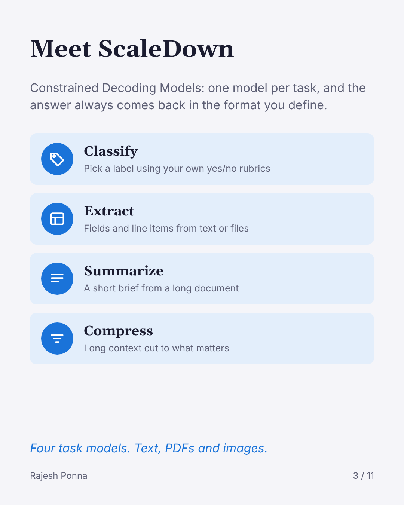
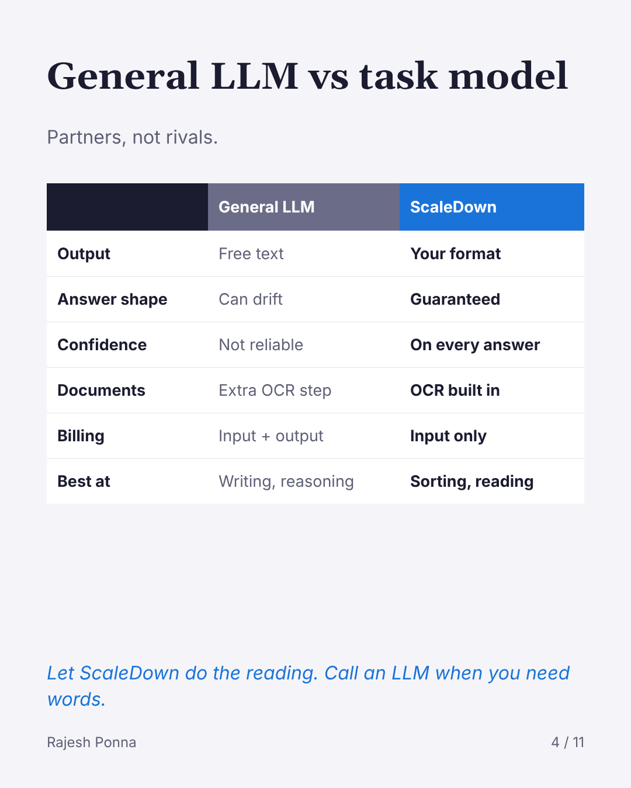
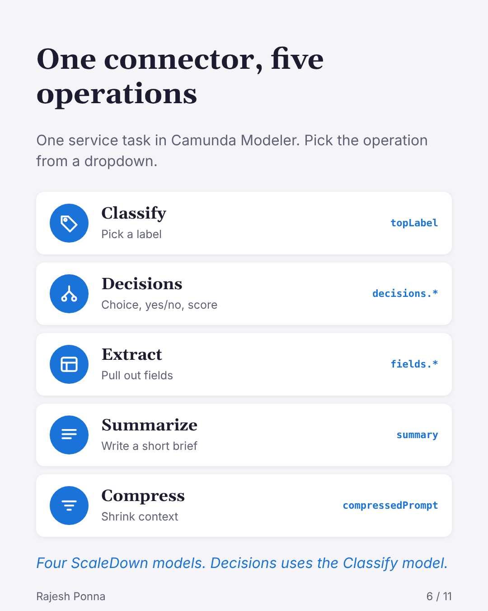
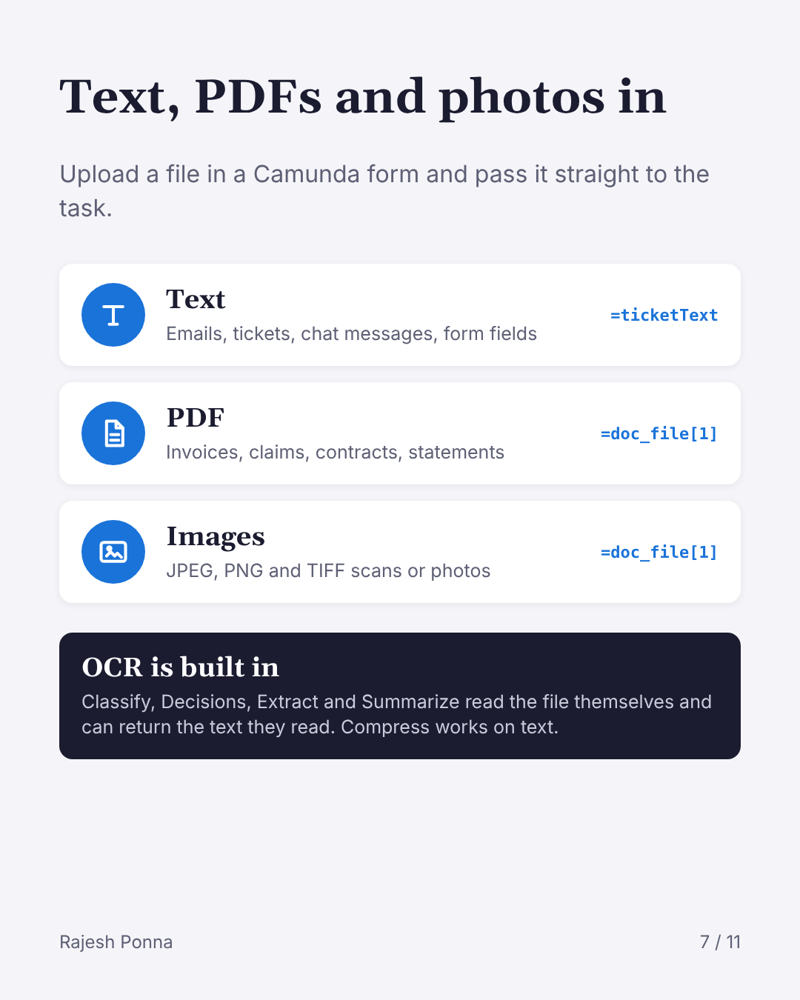
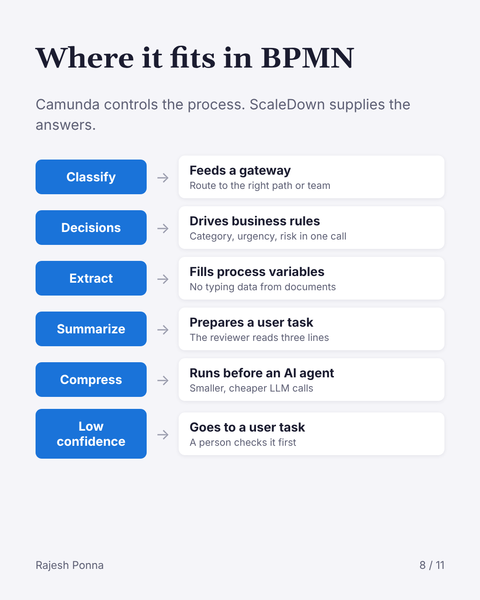
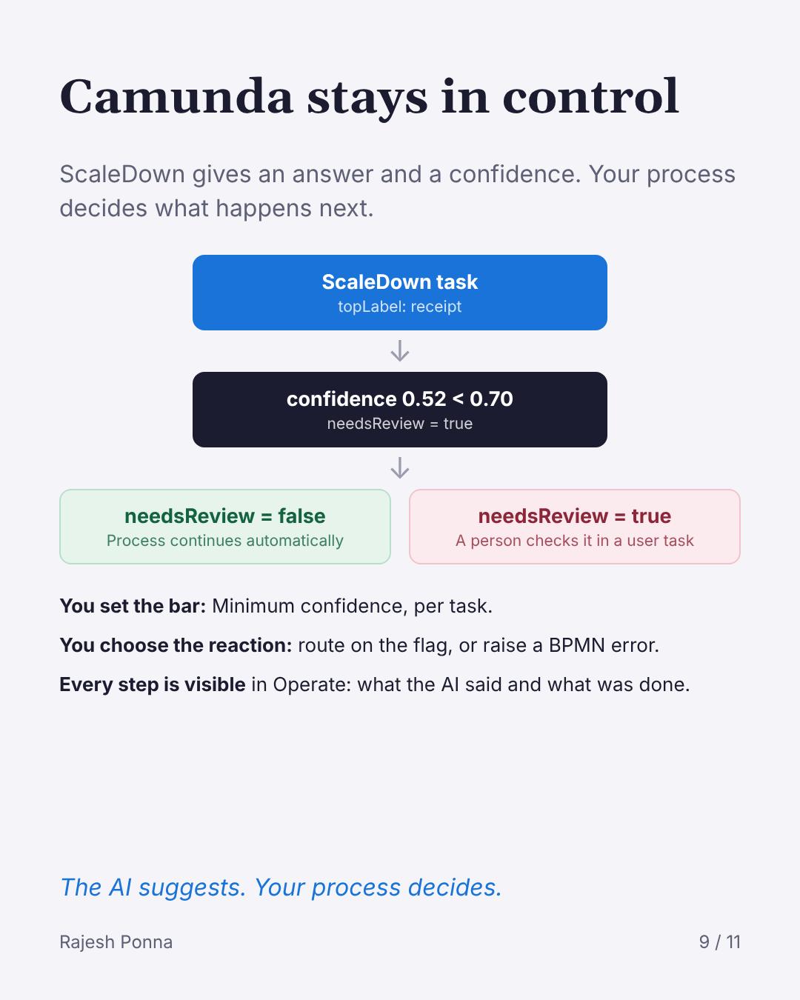
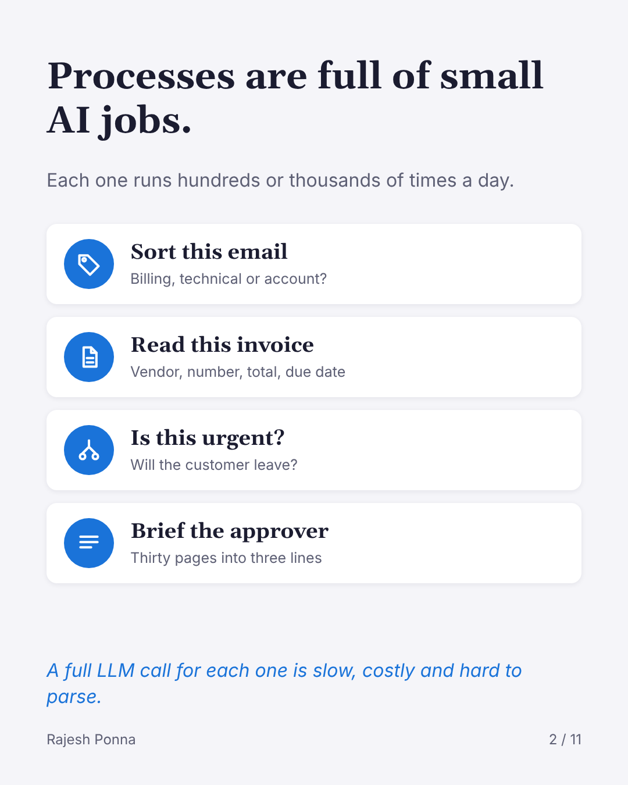
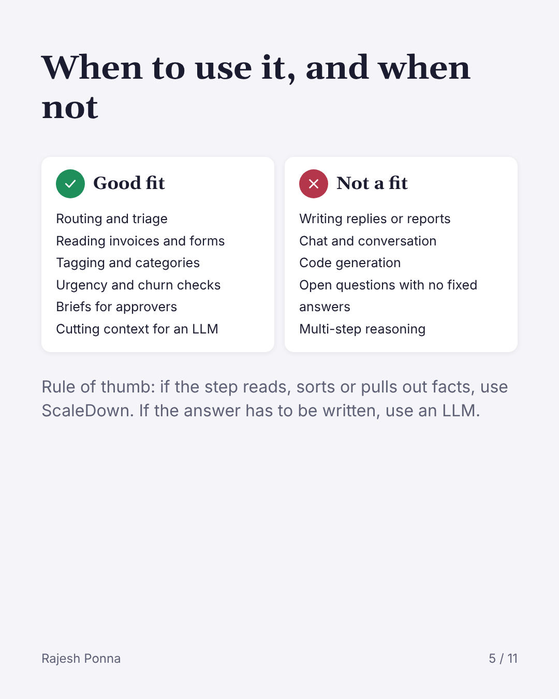
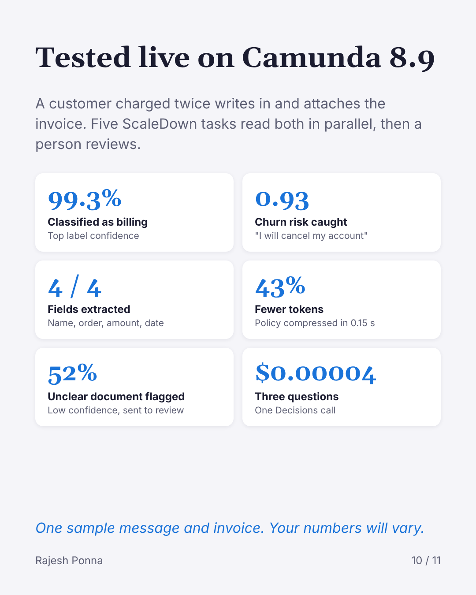

# ScaleDown Connector for Camunda 8

Bring **ScaleDown's task-specific AI models** into your BPMN processes: classify a message, answer
yes/no and scoring questions, extract fields from an invoice, summarize a long document, or
compress context before an LLM call. It works on plain text, PDFs and images (OCR is built in).

Every answer comes back as structured data with a confidence score, so gateways, business rules
and user tasks can use it directly. No prompt parsing, no JSON repair.


## At a glance

<table>
  <tr>
    <td></td>
    <td></td>
    <td></td>
  </tr>
  <tr>
    <td></td>
    <td></td>
    <td></td>
  </tr>
  <tr>
    <td></td>
    <td></td>
    <td></td>
  </tr>
</table>

All slides are in [docs/images](docs/images).

---

## Contents

- [What is ScaleDown](#what-is-scaledown)
- [How constrained decoding works, in plain words](#how-constrained-decoding-works-in-plain-words)
- [General LLM vs ScaleDown](#general-llm-vs-scaledown)
- [Where ScaleDown fits in Camunda](#where-scaledown-fits-in-camunda)
- [When to use it, and when not](#when-to-use-it-and-when-not)
- [Features](#features)
- [Operations](#operations)
- [Quick start](#quick-start)
- [The element template, field by field](#the-element-template-field-by-field)
- [Response structure](#response-structure)
- [Confidence and human review](#confidence-and-human-review)
- [Errors and retries](#errors-and-retries)
- [Examples](#examples)
- [Live test results](#live-test-results)
- [Security](#security)
- [Limitations](#limitations)
- [Troubleshooting](#troubleshooting)
- [Build from source](#build-from-source)
- [Disclaimer](#disclaimer)

---

## What is ScaleDown

**ScaleDown** offers small AI models that each do **one job** well, instead of one big model that
tries to do everything. ScaleDown calls them **CDMs (Constrained Decoding Models)**.

Think of the difference between a general assistant and a specialist:

- A **general LLM** (GPT, Claude, Llama, Qwen...) is like a smart generalist. Ask it anything and it
  writes an answer in free text. You then have to read that text and hope it is in the shape you
  wanted.
- A **ScaleDown model** is like a specialist with a form to fill in. You hand it the form (the labels,
  the fields, the questions), it reads the input, and it fills in exactly that form. Nothing else.

### The four ScaleDown models

| Model | What it does | Everyday example |
|---|---|---|
| **Classify** | Picks the best label for a text or document, using yes/no rubrics you write | "Is this email about billing, a bug, or account access?" |
| **Extract** | Pulls named fields and line items out of text or documents | "From this invoice, give me vendor, invoice number, total and due date" |
| **Summarize** | Writes a short summary, with optional instructions | "Give the approver a three-line brief of this 30-page contract" |
| **Compress** | Shortens long context while keeping what matters for your question (text only) | "Cut this 20-page policy down before sending it to an LLM agent" |

On top of Classify, ScaleDown offers a **Decisions** API: you ask several named questions about the
same input in one request. Each question has a fixed answer type:

| Type | Answer | Example question |
|---|---|---|
| **choice** | One option from a list you define | "Which department should handle this?" |
| **noul** | A probability from 0 to 1 (yes/no strength) | "Is the customer threatening to cancel?" |
| **score** | One level on an ordered scale you define (2 to 10 levels) | "How severe is this: Low, Medium, High, Critical?" |

### Documents and OCR

Classify, Decisions, Extract and Summarize accept **PDF, JPEG, PNG and TIFF** files directly.
ScaleDown runs OCR (reads the text from the scan or photo) as part of the same call, so you do not
need a separate OCR step. The connector can also return the text it read (`ocrText`).

Compress works on **text only**.

---

## How constrained decoding works, in plain words

A normal LLM writes its answer one word (token) at a time and can pick any word at each step. That
is why it sometimes adds a sentence you did not ask for, invents a label you never offered, or
returns broken JSON.

**Constrained decoding** limits the choices at every step to what your format allows. If you asked
for one of `billing`, `technical`, `account`, then those are the only answers that can come out. If
you asked for an object with `vendor` and `totalAmount`, you get exactly that object.

Two things to keep in mind:

1. **The format is guaranteed. The accuracy is not.** The model can still pick the wrong label or
   misread a number. That is why every answer comes with a **confidence score**, and why this
   connector lets you route low-confidence results to a person.
2. **You define the answer space.** Clear labels, rubrics and field descriptions give better results.
   A rubric such as "Is this about a charge, invoice, refund or payment?" works better than just
   "billing".

---

## General LLM vs ScaleDown

| | General LLM | ScaleDown |
|---|---|---|
| **Output** | Free text, generated word by word | Exactly the format you define |
| **Answer shape** | Can drift: extra text, invalid labels, broken JSON | Guaranteed by constrained decoding |
| **Confidence** | Not reliably available | A score on every answer |
| **Documents** | Usually needs a separate OCR step first | OCR built into the call |
| **Parsing in your process** | Needed, and can fail | None |
| **Several questions** | One long prompt or several calls | Decisions: many questions, one request |
| **Best at** | Writing, explaining, reasoning, coding, chat | Sorting, reading, extracting, scoring, summarizing |

They work well together. A common pattern in a process:

```
Compress (shrink the context)  →  LLM / AI agent (write the reply)
Classify (route the ticket)     →  LLM only for the tickets that need a written answer
```

Let ScaleDown do the reading and sorting. Call an LLM when you need words.

---

## Where ScaleDown fits in Camunda

Camunda decides **what happens next** in a process. ScaleDown supplies the **facts and decisions**
that Camunda needs to choose a path. The connector is a normal outbound service task, so it fits
anywhere a service task fits.

| ScaleDown operation | Typical place in BPMN | What it gives the process |
|---|---|---|
| **Classify** | Before an exclusive gateway | `topLabel` to route on, e.g. billing vs technical |
| **Decisions** | Before a gateway or a business rule task (DMN) | Category, churn risk and severity in one call |
| **Extract** | After a document upload | Process variables filled from the file: vendor, amount, dates |
| **Summarize** | Before a user task | A short brief so the reviewer does not read 30 pages |
| **Compress** | Before an AI agent or LLM connector | Smaller prompts, lower LLM cost |
| **Low confidence** | Gateway on `needsReview` | A user task where a person checks the result |

A typical document flow:

```
Form upload → Classify (what kind of document?) → Gateway
                 ├─ invoice → Extract (fields) → Business rule → Approve user task
                 ├─ claim   → Summarize → Adjuster user task
                 └─ unclear (needsReview = true) → Manual review user task
```

Parallel gateways work well here: Classify, Decisions, Extract and Summarize can read the same
input at the same time and join before the user task.

---

## When to use it, and when not

### Good fits

- **Routing and triage**: which team, which queue, which path.
- **Reading documents**: invoices, claims, receipts, forms, bank statements, contracts.
- **Tagging**: category, intent, language, document type.
- **Risk and urgency checks**: churn risk, fraud hints, severity.
- **Briefs for people**: a short summary in front of an approver or adjuster.
- **Cutting LLM cost**: compress context before an AI agent.
- **High volume**: steps that run thousands of times a day.

### Not a fit

- Writing emails, replies or reports that a person will read as the final text.
- Chat and conversation.
- Code generation.
- Open questions where you cannot list the possible answers or fields.
- Long multi-step reasoning or math.

**Rule of thumb:** if the step reads, sorts or pulls out facts, use ScaleDown. If the answer has to
be written, use an LLM.

---

## Features

- **Five operations in one connector**: Classify, Decisions, Extract, Summarize, Compress.
- **Text, documents or chunks** as input. Documents come straight from a Camunda form upload.
- **OCR built in** for PDF, JPEG, PNG and TIFF, with optional `ocrText` in the result.
- **Confidence on every answer** and a single `needsReview` flag for gateways.
- **Low-confidence handling**: flag it, or raise a `SCALEDOWN_LOW_CONFIDENCE` BPMN error.
- **Clear error codes** for bad input, bad key, missing credits, rate limits, timeouts and outages.
- **Smart retries**: temporary problems are retried with backoff (honoring `Retry-After`), while
  permanent problems fail at once so you do not burn retries.
- **Camunda secrets** for the API key.
- **Input checks before calling ScaleDown**: label limits, chunk limits, file size and type.
- **HTTPS enforced** (except localhost, for testing).
- **A clean properties panel**: only the fields for the chosen operation are shown.

---

## Operations

| Operation | Use it for | Main result fields |
|---|---|---|
| **Classify** | Pick the best label for a text, a document or each chunk | `topLabel`, `confidence`, `scores`, `reasoning` |
| **Decisions** | Several choice / noul / score questions about one input | `decisions.<id>`, `confidences.<id>`, `flags.<id>` |
| **Extract** | Fields or a full JSON schema from text or a document | `fields.<name>`, `confidences.<name>`, `missingFields` |
| **Summarize** | A short summary of text or a document | `summary`, `truncated` |
| **Compress** | Shrink context before an LLM call (text only) | `compressedPrompt`, `tokensSaved`, `compressionRatio` |

Four ScaleDown models, five connector operations: Decisions runs on the Classify model.

---

## Quick start

### Requirements

- Camunda 8.9 Self-Managed (Docker Compose) or a compatible connectors runtime
- Java 21 and Maven, to build
- A ScaleDown API key

### 1. Build

```bash
mvn clean package
```

This produces `target/scaledown-connector-1.0.1.jar`.

### 2. Add your API key as a secret

Camunda 8.9 only exposes environment variables that start with `SECRET_` as connector secrets.
In `connector-secrets.txt` (next to your `docker-compose.yaml`):

```
SECRET_SCALEDOWN_API_KEY=your_api_key
```

The template field keeps `{{secrets.SCALEDOWN_API_KEY}}`. The runtime adds the prefix itself.

### 3. Load the jar into the connectors container

In `docker-compose.yaml`, under the `connectors` service:

```yaml
    environment:
      - LOADER_PATH=/opt/custom
    env_file: connector-secrets.txt
    volumes:
      - ./scaledown-connector-1.0.1.jar:/opt/custom/scaledown-connector.jar
```

Then recreate the container:

```bash
docker compose up -d --force-recreate connectors
docker compose logs connectors | grep -i scaledown
```

You should see the connector registered with type `io.github.rajeshponna:scaledown:1`.

**Alternative:** `docker build -t scaledown-connectors .` with the included `Dockerfile`, and use
that image instead of `camunda/connectors-bundle`.

### 4. Import the element template

- **Desktop Modeler:** copy `element-templates/scaledown-connector.json` into the
  `resources/element-templates` folder (on Windows: `%APPDATA%\camunda-modeler\resources\element-templates`)
  and restart Modeler.
- **Web Modeler:** upload the file to your project and click **Publish**.

### 5. Use it

Add a service task, click **Template → Select**, and choose **ScaleDown Connector**. Pick an
operation and fill in the fields shown for it.

---

## The element template, field by field

The properties panel is split into groups. Only the groups for the selected operation are shown.

### 1. Operation

| Field | Values | What it does |
|---|---|---|
| Operation | `classify`, `decisions`, `extract`, `summarize`, `compress` | Chooses which ScaleDown model to call. Changing it shows the matching group below. |

### 2. Authentication

| Field | Default | What it does |
|---|---|---|
| API key | `{{secrets.SCALEDOWN_API_KEY}}` | Sent to ScaleDown as the `x-api-key` header. Keep it as a secret reference. A key typed in here is saved inside the BPMN file and visible in Operate. |

### 3. Input (Classify, Decisions, Extract, Summarize)

Compress has its own input fields (see Compress below).

| Field | When shown | What it does |
|---|---|---|
| Input source | always | `text`, `document` or `chunks`. Tells the connector what you are sending. |
| Text | source = text | The text to process. Usually a FEEL expression such as `=emailBody` or `=ticketText`. With a document, Extract and Summarize also use this as an extra instruction if you fill it. |
| Document | source = document | A Camunda document reference. From a form file picker the value is a **list**, so use `=doc_file[1]` (first file). From an inbound connector it is often `=documents[1]`. |
| MIME type override | source = document | Only needed when the document has no content type in its metadata. Accepts `application/pdf`, `image/jpeg`, `image/png`, `image/tiff`. Common aliases such as `jpg` or `pdf` are normalized. |
| Chunks | source = chunks (Classify) | A list of strings, or a list of `{id, text}`. Each chunk is classified against the same labels in one request, e.g. every line of a chat or every page of a report. Max 50. |

How the connector handles a document: it loads the file from Camunda's document store, checks the
type (PDF, JPEG, PNG, TIFF; falls back to the file extension), checks the size (20 MB max), and
sends it base64-encoded with its MIME type. ScaleDown runs OCR as part of the call.

### 4. Classify

| Field | Default | What it does |
|---|---|---|
| Labels | three example labels | A FEEL context of `label: rubric`, or a list of `{name, rubric}`. A **rubric is a yes/no question** where "yes" means the label applies. Up to 20 labels (16 in multi-label mode). |
| Multi-label | off | Off: pick one winner. On: score every label on its own and return all labels above the threshold in `matchedLabels`. Use it for tags, where a ticket can be both "billing" and "urgent". |
| Multi-label threshold | ScaleDown default | Labels scoring at or above this value (0 to 1) are returned in `matchedLabels`. |
| Include reasoning | on | Adds a one-sentence explanation of the choice (single-label only). Turn it off to save a model call when you only need the label. |

Example labels:

```feel
={
  "billing": "Is this about a charge, invoice, refund or payment?",
  "technical": "Is this about a bug or something not working?",
  "account": "Is this about login, access or account settings?"
}
```

Tip: Classify always returns a winner, even when no label fits well. Set **Minimum confidence** so
weak answers go to a person.

### 5. Decisions

| Field | Default | What it does |
|---|---|---|
| Model | `classify-1` | `classify-1` (pinned version, stable results) or `classify` (latest). |
| Questions | example with three questions | A FEEL context of named questions. Each question has a `type` and its own settings. Every question is a separately billed model call, all answered in one request. |

Question types:

| Type | Settings | Result in `decisions.<id>` |
|---|---|---|
| `choice` | `instructions`, `criteria` (map of option → description) | The chosen option, e.g. `"billing"` |
| `noul` | `instructions` | A probability 0 to 1. `flags.<id>` is `true` when it is 0.5 or more |
| `score` | `criteria` (list of 2 to 10 ordered levels), optional `instructions` | The chosen level, e.g. `"High"` |

Example:

```feel
={
  "category": {
    "type": "choice",
    "instructions": "Which category best describes the request?",
    "criteria": {
      "billing": "About a charge, invoice, refund or payment.",
      "technical": "About a bug or something not working."
    }
  },
  "churnRisk": {
    "type": "noul",
    "instructions": "Is the customer threatening to cancel or leave?"
  },
  "severity": {
    "type": "score",
    "criteria": ["Low", "Medium", "High", "Critical"]
  }
}
```

Then route with `=scaledownResult.decisions.category = "billing"` or `=scaledownResult.flags.churnRisk`.

For a noul question, the confidence is how sure the model is either way: `max(p, 1 − p)`. A churn
probability of 0.93 has confidence 0.93; a probability of 0.5 has confidence 0.5 (unsure).

### 6. Extract

| Field | Default | What it does |
|---|---|---|
| Model | `extract-1` | `extract-1` (pinned) or `extract` (latest). |
| Schema mode | `fields` | `fields`: a simple list of field names and descriptions. `jsonSchema`: a full JSON schema for nested data such as line items. |
| Fields | invoice example | Shown in `fields` mode. A FEEL context of `fieldName: description`. Instruction-style descriptions work best, e.g. "Total amount due, including tax". |
| JSON schema | invoice example with line items | Shown in `jsonSchema` mode. An inline JSON schema. Supports objects, arrays and `enum`. Enum fields are routed to the classifier. `$ref` and `$defs` are not supported. |
| Instruction | empty | Optional global instruction for every field, e.g. "Dates in YYYY-MM-DD. Amounts as numbers without currency." |
| Minimum entity confidence | ScaleDown default | ScaleDown drops matches below this confidence (0 to 1). Dropped fields show up in `missingFields`. |
| Max matches per field | ScaleDown default | How many candidate values to return per field. All candidates are in `values.<name>`; the best one is in `fields.<name>`. |
| Context characters | ScaleDown default | How much surrounding text is returned with each match. Set 0 to keep the output small. |

Fields mode example:

```feel
={
  "vendor": "Name of the company that issued the invoice",
  "invoiceNumber": "Invoice number or ID",
  "invoiceDate": "Date the invoice was issued",
  "totalAmount": "Total amount due, including tax"
}
```

JSON schema example (line items and an enum):

```feel
={
  "type": "object",
  "properties": {
    "vendor": {"type": "string", "description": "Company that issued the invoice"},
    "lineItems": {
      "type": "array",
      "items": {
        "type": "object",
        "properties": {
          "description": {"type": "string"},
          "amount": {"type": "number"}
        }
      }
    },
    "status": {"type": "string", "enum": ["paid", "unpaid", "overdue"]}
  }
}
```

When you send only a document with no text, the connector sends the instruction
"Extract the requested fields from the attached document." because ScaleDown needs a non-empty
message.

### 7. Summarize

| Field | Default | What it does |
|---|---|---|
| Model | `summarize-1` | `summarize-1` (pinned) or `summarize` (latest). |
| Instruction | empty | Format, language, focus or length guidance, e.g. "Three bullet points for a claims adjuster. Mention amounts and dates." |
| Max output tokens | ScaleDown default | Upper limit for the summary length. ScaleDown caps it at 1000. When the limit is hit, `truncated` is `true`. |

### 8. Compress

| Field | Default | What it does |
|---|---|---|
| Context | empty | The long background text to shrink: retrieved documents, policies, chat history. Text only. |
| Prompt | empty | The question you will send to your LLM afterwards. It is kept intact and guides what is kept from the context. |
| Compression rate | `auto` | `auto` (recommended) lets ScaleDown decide. A number from 0 to 1 is the fraction of tokens to remove, e.g. `0.6` removes about 60%. |

Pass `=scaledownResult.compressedPrompt` to your LLM or AI agent connector.

### 9. Confidence and review (Classify, Decisions, Extract)

| Field | Default | What it does |
|---|---|---|
| Minimum confidence | empty (off) | A number from 0 to 1. Any answer below it sets `needsReview = true` and lists the weak answers in `lowConfidence`. |
| On low confidence | `flag` | `flag`: the task completes and you route on `needsReview`. `error`: the task throws `SCALEDOWN_LOW_CONFIDENCE`, which you can catch with an error boundary event. |

What is checked: Classify checks `confidence` (and each chunk); Decisions checks every question's
confidence; Extract checks the confidence of every field it found. Fields it could not find are
listed in `missingFields`, so add a gateway on `=count(extractResult.missingFields) > 0` if a
missing field should also go to a person.

### 10. Advanced

| Field | Default | What it does |
|---|---|---|
| Base URL | `https://api.scaledown.xyz` | Change only for a proxy or a private ScaleDown deployment. HTTPS is required, except for `localhost`. |
| Timeout (seconds) | `120` | How long to wait for ScaleDown. Max 600. Large PDFs and long summaries can take longer. |
| Include OCR text | off | Adds `ocrText`, the text ScaleDown read from the document. Useful for audits and debugging. It can be large; Camunda limits job output to about 1.5 MB. |
| Include raw response | off | Adds the unmodified ScaleDown response as `raw`. Useful for debugging. |

### 11. Output mapping

| Field | Default | What it does |
|---|---|---|
| Result variable | `scaledownResult` | The process variable that gets the whole result. **Use a different name per task** (e.g. `classifyResult`, `extractResult`) so parallel tasks do not overwrite each other. |
| Result expression | empty | Map parts of the result to separate variables, e.g. `={docType: response.topLabel, needsReview: response.needsReview}`. |

### 12. Error handling

| Field | What it does |
|---|---|
| Error expression | Turns connector errors into BPMN errors that boundary events can catch, e.g. `=if error.code = "SCALEDOWN_LOW_CONFIDENCE" then bpmnError("LOW_CONFIDENCE", error.message) else null`. |

### 13. Retries

| Field | Default | What it does |
|---|---|---|
| Retries | `3` | How many times Camunda retries the job for temporary problems: rate limits, timeouts, outages. Bad input, a bad key and missing credits fail at once, with no retries. |
| Retry backoff | `PT30S` | ISO-8601 wait between retries. A `Retry-After` header from ScaleDown takes precedence. |

---

## Response structure

Every result has `operation`, `needsReview` and `lowConfidence`, plus the fields for that operation.

**Classify**

```json
{
  "operation": "classify",
  "topLabel": "billing",
  "confidence": 0.993,
  "scores": { "billing": 0.993, "technical": 0.004, "account": 0.003 },
  "reasoning": "The customer reports being charged twice for one order.",
  "needsReview": false,
  "lowConfidence": []
}
```

Multi-label adds `matchedLabels`. Chunks add `results` (one entry per chunk with `id`, `topLabel`,
`confidence`, `matchedLabels`, `scores`) and `chunkCount`.

**Decisions**

```json
{
  "operation": "decisions",
  "decisions":   { "category": "billing", "churnRisk": 0.93, "severity": "High" },
  "confidences": { "category": 0.989,     "churnRisk": 0.93, "severity": 0.37 },
  "flags":       { "churnRisk": true },
  "answers": { "...": "full answer per question" },
  "usage": { "...": "token and cost info" },
  "needsReview": true,
  "lowConfidence": ["severity"]
}
```

**Extract**

```json
{
  "operation": "extract",
  "fields":      { "vendor": "Lumen Electronics", "invoiceNumber": "LE-2026-45821", "totalAmount": "55,000" },
  "confidences": { "vendor": 0.94, "invoiceNumber": 0.97, "totalAmount": 0.646 },
  "values":      { "totalAmount": ["55,000"] },
  "missingFields": [],
  "structuredResult": { "...": "the schema-shaped object" },
  "entities": [ { "type": "vendor", "text": "Lumen Electronics", "confidence": 0.94 } ],
  "needsReview": false,
  "lowConfidence": []
}
```

**Summarize**

```json
{
  "operation": "summarize",
  "summary": "Customer was charged twice for order 45821 and asks for a refund...",
  "truncated": false,
  "finishReason": "stop",
  "needsReview": false,
  "lowConfidence": []
}
```

**Compress**

```json
{
  "operation": "compress",
  "compressedPrompt": "...",
  "originalTokens": 115,
  "compressedTokens": 65,
  "tokensSaved": 50,
  "compressionRatio": 0.57,
  "latencyMs": 150,
  "needsReview": false,
  "lowConfidence": []
}
```

With **Include OCR text** you also get `ocrText`; with **Include raw response** you get `raw`.

### Useful FEEL expressions

| Need | Expression |
|---|---|
| Route on the label | `=classifyResult.topLabel = "billing"` |
| Send weak answers to a person | `=classifyResult.needsReview` |
| A decision value | `=decisionsResult.decisions.category` |
| Churn yes/no | `=decisionsResult.flags.churnRisk` |
| An extracted field | `=extractResult.fields.totalAmount` |
| Anything missing? | `=count(extractResult.missingFields) > 0` |
| Summary for a user task form | `=summaryResult.summary` |
| Compressed prompt for an LLM | `=compressResult.compressedPrompt` |

---

## Confidence and human review

Constrained decoding guarantees the format, not the truth. Confidence is how you decide when to
trust the answer:

1. Set **Minimum confidence** (0.7 is a reasonable start; tune it on your own data).
2. Add an exclusive gateway after the task with a condition on `needsReview`.
3. Send `needsReview = true` to a user task where a person checks or corrects the result.

Or choose **On low confidence = error** and catch `SCALEDOWN_LOW_CONFIDENCE` with an error boundary
event, if you prefer that style.

In our live test, a scanned document scored 0.516 for "receipt" and 0.378 for "invoice". The model
still gave an answer, but with **Minimum confidence** at 0.7 the process sent it to a person. That
is the behavior you want.

---

## Errors and retries

| Code | When | Retried? |
|---|---|---|
| `SCALEDOWN_INVALID_INPUT` | Caught before calling ScaleDown: missing text, too many labels, bad threshold, wrong field type | No |
| `SCALEDOWN_UNSUPPORTED_DOCUMENT` | File type is not PDF, JPEG, PNG or TIFF, or larger than 20 MB | No |
| `SCALEDOWN_INVALID_REQUEST` | ScaleDown rejected the request (400, 404, 413, 422) | No |
| `SCALEDOWN_UNAUTHORIZED` | Wrong, missing or revoked API key (401, 403) | No |
| `SCALEDOWN_INSUFFICIENT_CREDITS` | Out of credits (402) | No |
| `SCALEDOWN_RATE_LIMITED` | Too many requests (429) | Yes, honors `Retry-After` |
| `SCALEDOWN_TIMEOUT` | ScaleDown or the network timed out (504, client timeout) | Yes |
| `SCALEDOWN_UNAVAILABLE` | Server errors (5xx) or network failures | Yes |
| `SCALEDOWN_INVALID_RESPONSE` | ScaleDown answered with something the connector could not read | No |
| `SCALEDOWN_LOW_CONFIDENCE` | Only when **On low confidence = error** | No |

"No" means the job fails immediately with zero retries, so an incident shows up in Operate right
away instead of after several wasted attempts. Errors include `httpStatus` and `responseBody`
variables where available.

Map codes to BPMN errors in **Error expression**:

```feel
=if error.code = "SCALEDOWN_LOW_CONFIDENCE" then bpmnError("LOW_CONFIDENCE", error.message)
 else if error.code = "SCALEDOWN_INSUFFICIENT_CREDITS" then bpmnError("NO_CREDITS", error.message)
 else null
```

---

## Examples

All examples are in [examples](examples) and run on Camunda 8.9 Self-Managed.

| Example | What it shows |
|---|---|
| [`scaledown-connector-test.bpmn`](examples/scaledown-connector-test.bpmn) | One task per operation, to check your setup |
| [`claim-intake.bpmn`](examples/claim-intake.bpmn) | Classify a claim, route on the label |
| [`support-triage/`](examples/support-triage) | Simple support ticket triage with Classify and a review path |
| [`invoice-showcase/`](examples/invoice-showcase) | Upload an invoice, classify, extract fields, approve; includes forms and sample documents |
| [`full-demo/`](examples/full-demo) | Ticket text plus an attachment, all five operations in parallel, OCR, low-confidence review |

Each folder has its own README with steps.

---

## Live test results

Measured on Camunda 8.9 Self-Managed with a real ScaleDown key, using one sample support message
("charged twice... I will cancel my account") and one sample document. Your numbers will vary.

| Operation | Result |
|---|---|
| Classify (text) | `billing` at 99.3% confidence |
| Decisions (3 questions) | category `billing` 0.989, churn risk 0.93, severity confidence 0.37 (flagged), cost about $0.000043 |
| Extract (text) | 4 of 4 fields found |
| Summarize (text) | Done in 0.55 s |
| Compress | 115 → 65 tokens (43% fewer) in about 150 ms |
| Classify (scanned document) | `receipt` 0.516 vs `invoice` 0.378, sent to review |

---

## Security

- Keep the API key in Camunda secrets (`SECRET_SCALEDOWN_API_KEY`). A key typed into the properties
  panel is stored in the BPMN file and visible in Operate.
- Never commit `connector-secrets.txt`. It is in `.gitignore`.
- If a key is ever exposed (screenshots, chat, a pushed BPMN file), revoke it in the ScaleDown
  dashboard and create a new one.
- Text and documents are sent to ScaleDown's API. Check your data policies before sending personal
  or sensitive data.
- `ocrText` and `raw` can contain the full document text. Leave them off in production unless you
  need them.

---

## Limitations

- Classify: max 20 labels (16 in multi-label mode); max 50 chunks per request.
- Documents: PDF, JPEG, PNG, TIFF only; 20 MB max per file.
- Compress accepts text only.
- Summarize output is capped at 1000 tokens by ScaleDown.
- Extract JSON schemas cannot use `$ref` or `$defs`.
- Camunda limits job output to about 1.5 MB, so be careful with `ocrText` on large documents.
- Accuracy depends on your labels, rubrics and field descriptions. Test on real samples and tune
  **Minimum confidence**.
- ScaleDown pricing, limits and models may change. Check the ScaleDown docs for current details.

---

## Troubleshooting

| Symptom | Cause | Fix |
|---|---|---|
| Task waits forever, no incident | Jar not loaded by the runtime | Mount it under `LOADER_PATH` (`/opt/custom`), recreate the container, check logs |
| `Secret with name 'SCALEDOWN_API_KEY' is not available` | Camunda 8.9 secret prefix | Use `SECRET_SCALEDOWN_API_KEY=...` in `connector-secrets.txt`, recreate the container |
| `SCALEDOWN_UNAUTHORIZED` | Wrong or revoked key | Check the secret value, recreate the container |
| `SCALEDOWN_INVALID_INPUT`: document expected | File picker value is a list | Use `=doc_file[1]`, not `=doc_file` |
| Classify ignores the uploaded file | Input source still set to Text | Set **Input source** to `document` |
| Extract on a document returns HTTP 400 "requires input text" | Connector older than 1.0.1 | Upgrade to 1.0.1 or later |
| Parallel results overwrite each other | Same result variable on several tasks | Use `classifyResult`, `extractResult`, and so on |
| Properties panel shows raw input mappings | Template not applied | Template → Select → ScaleDown Connector |
| Job output too large | `ocrText` on a big document | Turn off **Include OCR text** |

---

## Build from source

### Project structure

```
scaledown-connector/
├── README.md
├── LICENSE
├── pom.xml
├── .gitignore
├── docs/
│   └── images/                              carousel slides used in this README
│       ├── carousel-01-hook.png
│       ├── ...
│       └── carousel-11-closing.png
├── element-templates/
│   └── scaledown-connector.json             element template for Camunda Modeler
├── example-bpmn/                            quick-start example
│   ├── sclae-down.bpmn                      process with all ScaleDown operations
│   ├── scalefrom.form                       start form with text and file upload
│   ├── doc_file_sample_invoice.pdf          sample invoice to upload
│   ├── sclae-down.png                       process diagram
│   └── tasklist.png                         Tasklist screenshot
├── examples/                                more example processes
│   ├── scaledown-connector-test.bpmn        one task per operation, to check setup
│   ├── claim-intake.bpmn                    classify a claim and route it
│   ├── support-triage/                      ticket triage with a review path
│   ├── invoice-showcase/                    invoice upload, classify, extract, approve
│   └── full-demo/                           all five operations in parallel with OCR
└── src/
    ├── main/
    │   ├── java/io/github/rajeshponna/scaledown/
    │   │   ├── ScaleDownConnectorFunction.java   entry point, validation, review logic
    │   │   ├── client/
    │   │   │   ├── ScaleDownClient.java          HTTP calls, timeouts, HTTPS check
    │   │   │   └── ScaleDownErrors.java          error codes, retry vs fail-fast
    │   │   ├── document/
    │   │   │   └── DocumentEncoder.java          loads Camunda documents, type and size checks
    │   │   ├── model/
    │   │   │   ├── Operation.java                the five operations
    │   │   │   └── ScaleDownRequest.java         input binding for every template field
    │   │   └── operation/
    │   │       ├── ScaleDownOperation.java       common interface
    │   │       ├── ClassifyOperation.java
    │   │       ├── DecisionsOperation.java
    │   │       ├── ExtractOperation.java
    │   │       ├── SummarizeOperation.java
    │   │       ├── CompressOperation.java
    │   │       └── OperationSupport.java         shared input and confidence helpers
    │   └── resources/META-INF/services/
    │       └── io.camunda.connector.api.outbound.OutboundConnectorFunction
    └── test/java/io/github/rajeshponna/scaledown/
        ├── ScaleDownConnectorFunctionTest.java   tests for all operations and errors
        ├── MockScaleDown.java                    local fake ScaleDown server
        ├── TestDocument.java
        └── TestContext.java
```

### Requirements

- Java 21
- Maven 3.9 or later

### Build

```bash
mvn clean package
```

This runs the tests and creates `target/scaledown-connector-1.0.1.jar`.

To build without running the tests:

```bash
mvn clean package -DskipTests
```

### Match your Camunda version

In `pom.xml`, set `version.connectors` to your Camunda version (default `8.9.12`):

```xml
<properties>
  <version.connectors>8.9.20</version.connectors>
</properties>
```

The connector SDK and Jackson are marked `provided`, so the jar stays small and uses the libraries
already inside the Camunda connectors runtime.

### After building

Copy `target/scaledown-connector-1.0.1.jar` next to your `docker-compose.yaml` and follow
[Quick start](#quick-start) from step 3.

```bash
mvn clean package        # build and run tests
mvn clean package -DskipTests
```

Set `version.connectors` in `pom.xml` to your Camunda version (default 8.9.12).

---

## Disclaimer

This is an independent community project. It is not affiliated with, endorsed by or supported by
ScaleDown or Camunda. "ScaleDown" and "Camunda" are trademarks of their respective owners. Results
above come from a small live test; verify accuracy, speed and cost against your own workloads and
the current ScaleDown documentation.

## License

Apache License 2.0. See `LICENSE`.

## Author

Rajesh Ponna · [github.com/rajeshponna](https://github.com/rajeshponna)